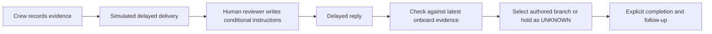

# BioTwin Sync

**Record health evidence onboard. Inspect its quality and personal history. Keep delayed advice tied to the evidence that still applies.**

BioTwin Sync is an offline Windows health-monitoring research prototype for the NASA Space Apps 2026 **Health Monitoring Software** challenge. It combines local measurement capture, NASA physiological-recording analysis, personal reference/history tools, source-linked onboard support, and a simulated crew–Earth consultation workflow. When Earth's reply arrives after the evidence has changed, a local evaluator checks the human-authored instructions against the latest compatible onboard evidence.

**For judges: [take the 3–5 minute technical tour](docs/JUDGES.md)** · [Inspect research evidence and results](docs/evidence/README.md) · [Browse the Python backend](biotwin) · [Browse the React interface](ui/presentation/src) · [Seven-slide presentation](docs/BioTwin-Sync-Submission.pdf)

| Existing work | Where to inspect it |
| --- | --- |
| Current app: manual/imported measurements, reaction check, history, recording inspection, assistant, delayed consultation and explicit follow-up | [Run from source](#run-the-current-interface-from-source), [desktop guide](docs/unified-desktop-guide.md) |
| Separate native research interface: NASA ECG model demo, controlled corruption, real fitted-model inference/report export and NASA historical reference library | [Optional research companion](docs/RESEARCH-COMPANION.md), [technical tour](docs/JUDGES.md#2-existing-native-research-tools-about-1-minute) |
| Scientific backend: signal preprocessing/beat estimates, two trained forest heads, ECG count-reliability experiment and four-policy evidence-link simulation | [Results, figures and reproduction](docs/evidence/README.md), [source map](docs/JUDGES.md#source-map) |

The 30-second checklist story is a compact entry point to this larger implementation. The native research tools and benchmark results are separate from the current React release; the [tour](docs/JUDGES.md) shows exactly where each belongs.

## Try the app

You can [run the current interface directly from source](#run-the-current-interface-from-source) now. Portable packages are prepared for release; check **[Releases](https://github.com/calavera16/BioTwin-Sync/releases)** for uploaded assets. For the primary current interface, use **BioTwinSync-0.1.0-windows-x64-v11-submission.zip** when available. Extract the entire ZIP, open its **BioTwinSync** folder and double-click **BioTwinSync.exe**. Keep all adjacent files and the resources folder together. Windows x64 only; Chromium and Python are included. No account, API key, development tools or Internet connection is needed for the packaged demo. This portable prototype is unsigned.

For the separate older native research interface, the optional **BioTwinSync-0.1.0-windows-x64-research-companion.zip** provides the NASA trained-model demo and historical reference tools without installing Python. It is a companion to the current app; the ECG count-reliability and evidence-link benchmarks remain source workflows. See [research companion details and exact navigation](docs/RESEARCH-COMPANION.md). Both package names describe prepared assets; source instructions remain available if release uploads are pending.

1. Choose **Watch 30-second example**. Earth reviews 420 ms while the onboard reading changes to 585 ms. The returned authored rule is evaluated against the newer reading.
2. Choose **View example checks**. Fresh 420 ms selects A; fresh 585 ms selects B; stale 585 ms returns UNKNOWN. Inspect the actual reason, freshness and authored steps.
3. Choose **Open workspace**. Record a reading, send a delayed consultation, review the reply and explicitly record completion. Crew and flight surgeon have separate views; Earth sees only delivered evidence.

Then explore **Measurements** for manual entry, supported CSV/JSON import and the five-trial browser reaction check; **Monitor** for source-separated history; **Recordings** for signal import, diagnostics, segment review and repeat requests; and **Assistant** for source-linked intake and reassessment. Export the session explicitly to preserve your work. The assistant uses authored rules and source material; it is separate from the experimental ECG models.


[Desktop guide](docs/unified-desktop-guide.md) · [Demo walkthrough](docs/demo-30s.md) · [Verification and limits](docs/VERIFICATION.md) · [Complete judge tour](docs/JUDGES.md)

## What is real, and what is simulated?

| Element | What it demonstrates |
| --- | --- |
| NASA SOTERIA ECG/BVP excerpts | Original samples from terrestrial flight-simulation research, with source timestamps and gaps. These are not astronaut disease labels. |
| NASA NLSP / WinSCAT work | Cognitive research schemas, phase/method distinctions and historical reference handling. Raw records are not redistributed. |
| 420 / 585 ms readings, threshold and 20-minute one-way delay | Explicitly synthetic workflow fixtures and an illustrative threshold. They are separate from the NASA waveforms. |
| A / B / UNKNOWN | Actual deterministic local rule evaluation. Branch names are not health or safety ratings. |

NASA's Human Research Program motivates the distance-from-Earth problem. Real recordings provide an inspectable research-data context; synthetic cases isolate the instruction-selection behavior. Sources, transformations and licenses are in [DATA_SOURCES.md](DATA_SOURCES.md).

## Design



React runs inside bundled Electron/Chromium. A Python standard-library backend owns validation, session state and rule evaluation through an authenticated loopback connection. It is one local computer simulating two roles, not a deployed Earth-to-space network. There is no live generative AI service or telemetry upload. Public source links use the browser only when selected.

## Run the current interface from source

Requires Python 3.13 or newer and a modern browser. Run from the repository root. The compiled frontend is included, so npm is unnecessary for this first run:

```powershell
python -c "from biotwin.presentation import PresentationHost; import webbrowser; h=PresentationHost().start(); webbrowser.open(h.url); input('Press Enter to stop BioTwin: '); h.close()"
```

For frontend development, install Node.js 22 or newer, then:

```powershell
npm --prefix ui/presentation ci --ignore-scripts
npm --prefix ui/presentation test
npm --prefix ui/presentation run build
```

Run the release-focused Python checks separately on Windows:

```powershell
python -m unittest tests.test_mission_demo
python -m unittest tests.test_presentation
python -m unittest tests.test_browser_host
python -m unittest tests.test_browser_workspace
python -m unittest tests.test_desktop_shell_build
node --test ui/desktop/test/*.test.cjs
```

The broader scientific/native test suite includes optional dependencies, display-dependent tests and local research data. It is not the clean-clone quick check. The separate older Tk research interface starts with `python run_desktop.py`.

To build a new Windows package, use a Python 3.13 virtual environment, install `requirements-build.lock.txt`, and run `python scripts/build_desktop_shell.py --tag your-unique-tag`. The builder downloads the pinned official Electron runtime and verifies its checksum. Never reuse an existing build tag. Numerical training dependencies are separate and are not required by the app.

## Limits and next validation

This is a hackathon research prototype, not clinical advice or flight-approved software. No live sensors, diagnosis, prescribing, clinical outcome benefit or security certification is claimed. Browser reaction timing is uncalibrated. Exported session JSON is unencrypted; use fictional data for public demonstrations. Explicitly export before closing to keep recorded work.

Experimental ECG models retain their failed or unavailable gates; they are not promoted as validated health models. The evidence-link experiment established bounded transport behavior, not useful bandwidth savings or policy superiority. A separate Windows computer, native Save/Open dialogs and a study with unfamiliar users remain next validation steps.

## License, attribution and AI use

Original project code and documentation are offered under the [MIT license](LICENSE). Third-party data, dependencies and runtime components retain their own licenses; see [DATA_SOURCES.md](DATA_SOURCES.md) and included notices. NASA, dataset authors and dependency authors do not endorse this project.

AI-assisted implementation, tests, writing and synthetic fixtures are disclosed in [SI_USE.md](AI_USE.md) and machine-readable [SI_USAGE.json](AI_USAGE.json). The presentation's generated illustration is visibly labeled. The declaration also belongs in the official Space Apps submission form.
