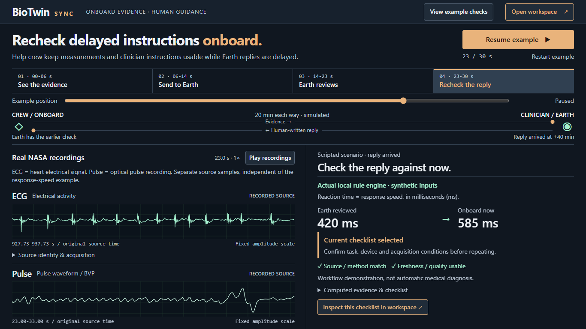
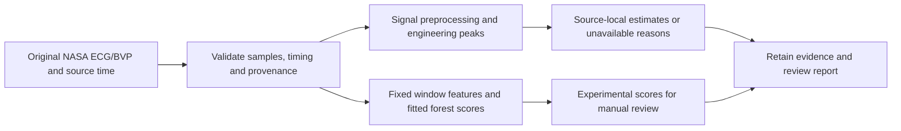
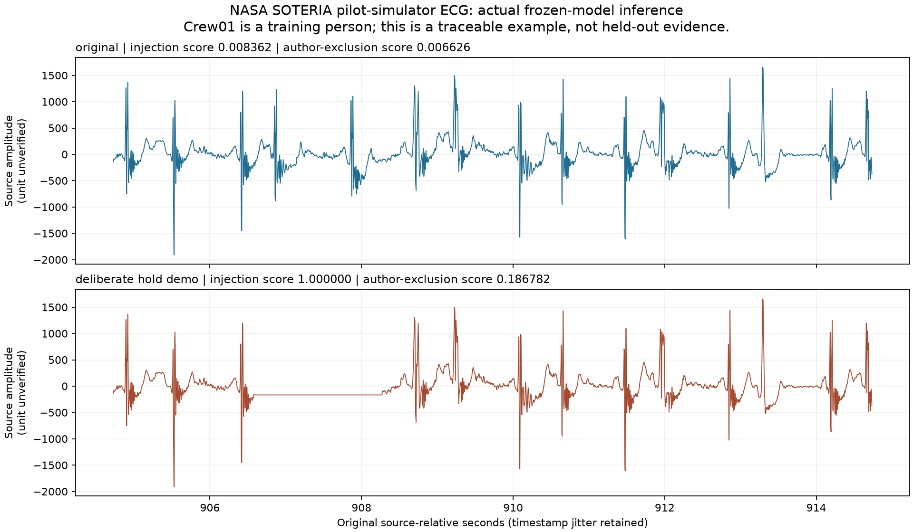
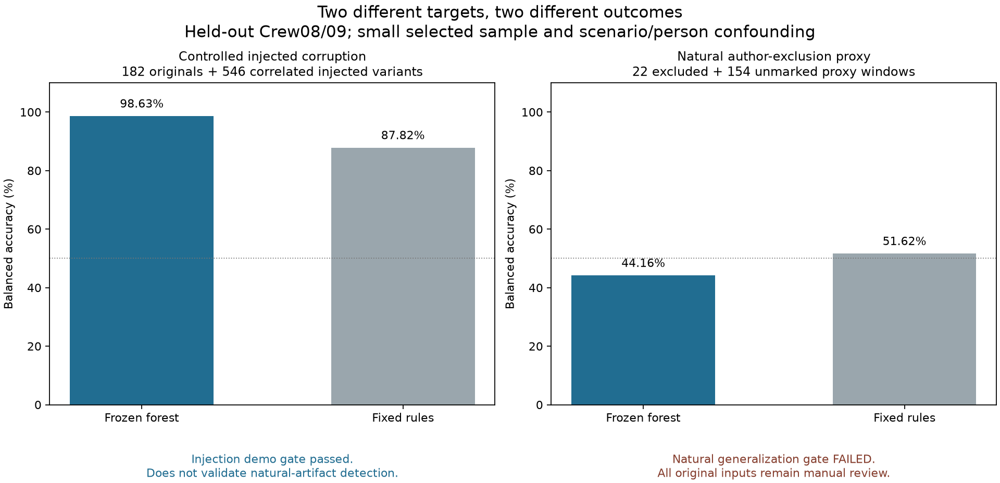

# BioTwin Sync: a 3–5 minute technical tour

**An offline health-evidence workflow for a crew whose next reply from Earth may already be out of date.** BioTwin brings together local recording, personal history, signal review, onboard support and delayed consultation. Its central question is practical: what evidence supports an instruction *now*, and when should the software ask for a new measurement instead?

The repository contains three layers of completed work. This tour separates the current app, the existing native research tools and the scientific experiments so each can be judged on its actual behavior.

[Source launch](../README.md#run-the-current-interface-from-source) · [Download release v0.1.0](https://github.com/calavera16/BioTwin-Sync/releases/tag/v0.1.0) · [Seven-slide presentation](BioTwin-Sync-Submission.pdf) · [Evidence and reproduction](evidence/README.md) · [Source attribution](../DATA_SOURCES.md)

## 1. Current app: collect, review and follow up (about 1 minute)

Download **[BioTwinSync-0.1.0-windows-x64-v11-submission.zip](https://github.com/calavera16/BioTwin-Sync/releases/download/v0.1.0/BioTwinSync-0.1.0-windows-x64-v11-submission.zip)**, extract the entire ZIP, open its **BioTwinSync** folder and run **BioTwinSync.exe**. The unsigned Windows x64 portable app includes Chromium and Python. Its packaged local demonstration needs no login, key, development tools or network connection. The current interface also [runs directly from this repository](../README.md#run-the-current-interface-from-source).

Start with **Watch 30-second example**, then **View example checks**. A clinician reviews a synthetic 420 ms reaction-time observation while the crew later records 585 ms. On reply receipt, the real local evaluator uses the latest compatible evidence to choose an authored branch. The same 585 ms reading becomes UNKNOWN when too old. These illustrative values, thresholds and simulated delays are workflow fixtures, separate from NASA recordings.

Then choose **Open workspace** and inspect the broader implementation:

| Tool | Implemented behavior |
| --- | --- |
| Measurements | Manual readings with acquisition time, device/method and source; supported CSV/JSON import; five-trial browser reaction check |
| Monitor and history | Source/context-separated observations, descriptive personal references when sufficient comparable history exists, explicit missing values |
| Recordings | Supported signal JSON import, sample inspection and quality diagnostics, segment review marks and repeat requests |
| Assistant | Structured intake, source-linked authored guidance, explicit action recording and reassessment as evidence changes |
| Crew / flight surgeon | Separate views; the Earth role sees only delivered evidence; simulated delayed consultation and reply |
| Self-check and sessions | Conditional instruction evaluation, explicit completion notes and follow-up; session JSON export/open |

The assistant is a rules-based, source-grounded support workflow. The ECG machine-learning experiments described below are separate. Opening a checklist never marks its steps complete. Export a session explicitly and complete the Save dialog to retain recorded work. The [desktop guide](unified-desktop-guide.md) explains each control.



## 2. Existing native research tools (about 1 minute)

Download the optional **[BioTwinSync-0.1.0-windows-x64-research-companion.zip](https://github.com/calavera16/BioTwin-Sync/releases/download/v0.1.0/BioTwinSync-0.1.0-windows-x64-research-companion.zip)**. This preserves the older native interface and includes its runtime, so no Python installation is needed. See [companion extraction and startup details](RESEARCH-COMPANION.md).

This is a **separate older interface**, not the primary current React app. It exposes the existing NASA trained-model demonstration and historical reference tools; it does not add a GUI for the ECG count-reliability or evidence-link benchmarks. As a source fallback, with Python 3.13 and Tk available, run from the repository root:

```powershell
python run_desktop.py
```

Navigate **Session > Local measurements > Signals > Open separate model demo**. You can also open a local monitor's **Signals** tools and select **Open separate model demo**:

1. Select **Load NASA ECG example** to analyze a bundled original SOTERIA excerpt with its own participant identity and source clock.
2. Inspect the actual fitted-model scores and analysis JSON. **Create labelled corrupted demo** applies a controlled sample-hold disruption and reruns inference. The altered copy is labeled synthetic corruption; the original recording is not assumed to be clean truth.
3. Mark a sample range, queue/resolve a repeat request and use **Export demo report**. The exported report contains source metadata, analysis and review actions, excluding raw source arrays. Demo marks remain separate from personal health histories.

Implementation: [native model demonstration](../biotwin/desktop.py), [signal analysis and controlled injection](../biotwin/signal_review.py), [data-only trained forest weights](../assets/desktop/signal-review-v2.json). Inference runs locally with the Python standard library; it is a real fitted model, not a scripted score animation.

The native **Flight Surgeon reference panel** also loads a local WinSCAT collection or explicitly fetches its 26 allowlisted public NASA files. Fetching requires Internet access; offline monitoring remains available without it. It shows separate historical query/reference trajectories using [context matching and deterministic DTW](../biotwin/cohort.py), not a validated match to the demo crew. Historical-analysis code also implements past-only sample mean/SD references and CUSUM change flags. These are descriptive comparisons, not clinical normal ranges. Raw NLSP records are not bundled in this repository.

The audited WinSCAT collection contains **272 assessments from 26 people**, yielding **2,448 metric observations**. Only **18 metric observations** had sufficient compatible earlier history for the personal-reference rule. That scarcity matters: a large-looking table does not imply a usable personal baseline. Method, phase, source identity and missing reference counts remain explicit; source reaction-time units and timezone remain unverified. See the [reference-library implementation](../biotwin/reference_library.py) and [NASA file manifest](../data/nlsp-download-manifest.json).

## 3. Research evidence: original data to measured results (about 1–2 minutes)

### NASA data is an input to computation

SOTERIA provides ECG and BVP from commercial-pilot flight simulations. BioTwin preserves selected original samples, source timing, gaps and attribution. The native replay/model tools consume those excerpts; the training experiment used separately tracked source recordings and participant-separated splits. These are terrestrial research recordings, not astronaut disease labels or current crew vitals.



The [signal-measurement backend](../biotwin/signal_measurements.py) implements moving-baseline removal, smoothing/envelope construction, peak selection and timing/regularity checks. Estimates abstain when source quality, sampling, missingness or peak support is unsuitable. There is no integrated raw-versus-processed comparison UI in the current release. ECG beat intervals and optical BVP pulse intervals retain different meanings; the code does not infer SpO2, sleep stages or clinically validated HRV.



### What the two trained forest heads learned

Each head uses 24 trees of maximum depth five and 12 fixed features. Training used Crew 01/02/03, validation Crew 05, and fresh held-out Crew 08/09. Original and injected versions of one participant stayed in the same split; there was no post-test tuning. Held-out selection used annotation metadata and changed both person and scenario, so it is not representative population sampling.

| Held-out target | Learned balanced accuracy | Fixed-rule baseline | Interpretation |
| --- | ---: | ---: | --- |
| Deliberately injected hold/clipping/noise | **98.63%** | 87.82% | Passed the controlled-corruption demonstration gate |
| Original NASA heartbeat-detector exclusions | **44.16%** | 51.62% | Failed the natural author-exclusion gate; manual review only |

The controlled test contains **182 original windows and 546 paired injections from two people**. Correlated windows and reused original negatives are not independent participants. The natural test contains 176 eligible original windows, including 22 author-excluded examples; sensitivity was only 9.09%. NASA's exclusion labels describe the source authors' heartbeat-detector usability and are incomplete quality proxies. An unmarked window does not establish clean ECG.

These results justify a controlled technical-disruption demonstration, while withholding automatic natural-signal acceptance. An earlier logistic quality classifier scored 28.46% held-out balanced accuracy and remains inactive; the later forest result does not erase that failure. The combined forest JSON is 111,383 bytes. Exported predictions matched scikit-learn to numerical precision; measured inference was about 1.44 ms per already-computed feature window on the development desktop, excluding feature extraction, startup and UI. This timing is not a flight-hardware benchmark.



Inspect [machine-readable results](evidence/results-summary.json), [example inference output](evidence/example-inference.json) and [reproduction instructions](evidence/README.md).

### Additional experiments, including negative results

| Experiment | Existing implementation and result | Why the boundary matters |
| --- | --- | --- |
| ECG count reliability | A separate logistic error-score model evaluated detector error against annotated MIT-BIH reference counts. The selected threshold retained 72/180 windows from nine held-out people: 40% coverage, 0.583 bpm count-rate MAE and 2/72 errors above 5 bpm. Five people had zero retained windows. The overall gate **failed**; the fixed-rules comparator retained none. | Low error on a selected minority cannot establish reliable coverage. Learned acceptance remains disabled. This is a different task/model from the NASA forest experiment. |
| NASA input compatibility | All 120 windows from six selected recordings were unavailable under the frozen count-reliability sampling rules: 114 sample-count mismatches and six timestamp-step failures. | Preserving source timing exposes a real compatibility problem. No physiological accuracy can be claimed from unavailable estimates. |
| Constrained evidence link | Four policies, matched serialized-byte budgets and simulated delays: 384 combinations completed; budgets held; 3,365 packets started and 3,053 arrived within source horizons. All 96 long-delay stress cases had no within-horizon delivery. | With no finite NASA source estimates, conditions remained UNKNOWN and numerical errors unavailable. This establishes transport behavior only, not policy superiority or useful physiological bandwidth savings. |

The source includes [ECG reliability](../biotwin/ecg_reliability.py), its [benchmark](../scripts/benchmark_ecg_reliability.py), the [evidence-priority policy](../biotwin/evidence_priority.py), and [link benchmark](../scripts/benchmark_evidence_link.py). The [evidence index](evidence/README.md) distinguishes reproduced local inference from reported historical benchmark results.

## How the pieces fit

Measurement review and communication are connected by explicit evidence, not by an inferred diagnosis. The backend keeps originals, context and uncertainty; personal references use earlier compatible observations; the sender/receiver simulation preserves what each role actually knows. Human-authored conditions can select A, B or UNKNOWN against the latest eligible evidence. Completion and follow-up remain operator actions.

The architecture is React inside Electron/Chromium with a packaged Python backend over an authenticated loopback connection. One computer simulates the crew and Earth; it is not a deployed space communication service. Snapshot digests and exact-base full/delta reconstruction provide consistency checks, not sender authentication, encryption or guaranteed compression.

## Source map

| Area | Inspectable source |
| --- | --- |
| Current user interface | [React source](../ui/presentation/src), [presentation host](../biotwin/presentation.py), [browser workspace](../biotwin/browser_workspace.py) |
| Recording/import and local evidence | [Local monitoring](../biotwin/local_monitoring.py), [reaction check](../biotwin/reaction_check.py), [session persistence](../biotwin/session.py) |
| Personal references and historical comparison | [Statistics](../biotwin/statistics.py), [change detection](../biotwin/cusum.py), [cohort comparison](../biotwin/cohort.py), [reference library](../biotwin/reference_library.py) |
| Signal processing and actual ML inference | [Engineering measurements](../biotwin/signal_measurements.py), [forest inference](../biotwin/signal_review.py), [training script](../scripts/train_signal_review.py), [forest asset](../assets/desktop/signal-review-v2.json) |
| Authored onboard support | [Assistant](../biotwin/health_assistant.py), [protocol content](../assets/desktop/assistant-protocols-v1.json) |
| Delayed consultation and conditional instructions | [Workflow](../biotwin/workflow.py), [protocol evaluator](../biotwin/protocol.py), [transport](../biotwin/transport.py) |
| Scientific extensions | [Count reliability](../biotwin/ecg_reliability.py), [evidence priority](../biotwin/evidence_priority.py), [benchmark scripts](../scripts) |
| Verification and provenance | [Tests](../tests), [release verification](VERIFICATION.md), [data sources/licenses](../DATA_SOURCES.md), [AI disclosure](../SI_USE.md) |

## What remains to validate

This hackathon prototype has no clinical validation or flight approval. Manual inputs are supplied observations, and browser reaction timing is uncalibrated. No live sensor integration, disease diagnosis, prescribing or demonstrated clinical outcome benefit is claimed. Session exports are unencrypted. The next scientific steps are timestamp-aware NASA input handling, a usable prespecified rules comparator and fresh evaluation with error **and** retained coverage; the next product checks are another Windows computer and unfamiliar-user testing.

NASA's research motivates the application and supplies genuine inspectable source data. It does not endorse BioTwin or validate its models. [Attribution and licenses](../DATA_SOURCES.md) and [AI-assisted work disclosure](../SI_USE.md) apply throughout.
