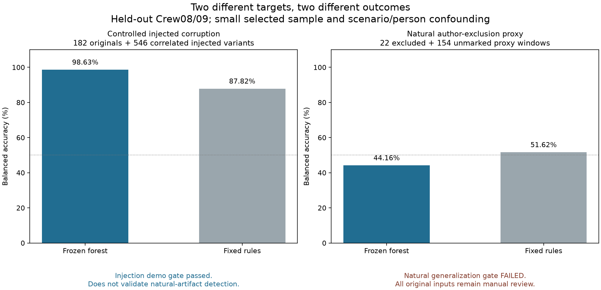
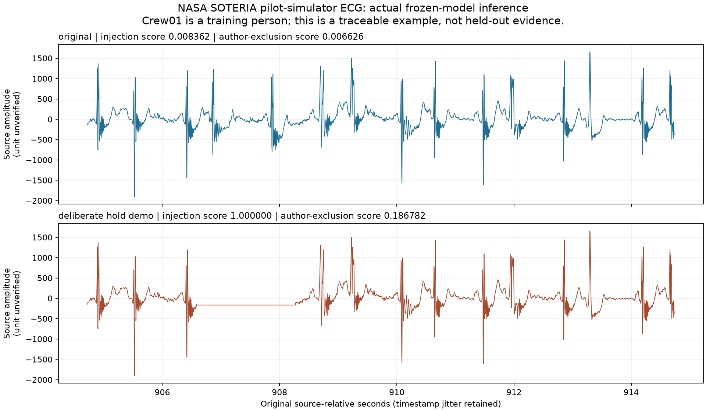

# Technical evidence: what was built and what actually worked

BioTwin contains working local signal processing, two fitted random-forest heads, a separate fitted ECG count-error scorer, cognitive-history reference logic, and a causal constrained-link simulator. These experiments preserve unavailable states and failed results. **No learned clinical acceptance is enabled; no astronaut or clinical validity is established.**

Start with the figures, the exact [results summary](results-summary.json), and the [actual inference output](example-inference.json). The summary curates completed frozen runs, including report identities and SHA-256 values; the original large reports and raw research datasets are not added here. See [data sources, transformations and licenses](../../DATA_SOURCES.md) and the [judge guide](../JUDGES.md).

## 1. NASA ECG: fitted models, not a placeholder score



Two CPU-trained random forests each contain 24 trees, maximum depth 5, minimum leaf 6, balanced class weights and seed 2026. They use 12 fixed dimensionless features from 2,560 original samples per nominal 10-second, 256 Hz ECG window: flat/hold fractions, extrema, normalized differences, crest factor, kurtosis, range/IQR, slope turns, lag correlation and block variability. The inference runtime uses finite JSON weights and Python's standard library, with schema, graph and digest checks; it does not load pickle or require scikit-learn.

Training used Crew01/02/03 left-seat scenario2; Crew05 scenario2 was report-only validation. Fresh held-out Crew08 scenario7 and Crew09 scenario5 were selected using annotation metadata. Person and scenario are confounded, the sample is small and enriched for exclusions, and injected variants of each original window are correlated. Both heads were fitted before fresh held-out waveforms were read. There was no post-test feature, threshold or hyperparameter tuning.

| Held-out target | Denominator | Forest sensitivity / specificity | Forest balanced accuracy | Fixed rules balanced accuracy | Outcome |
| --- | --- | --- | --- | --- | --- |
| Deliberately injected hold, clipping or noise burst | 182 originals + 546 paired injected variants | 98.90% / 98.35% | 98.63% | 87.82% | Controlled demo gate passed |
| Authors' detector exclusions vs unmarked proxies | 22 excluded + 154 unmarked windows; 6 boundary drops | 9.09% / 79.22% | 44.16% | 51.62% | Natural generalization gate **failed** |

Injection confusion is TN179 / FP3 / FN6 / TP540. Natural-proxy confusion is TN122 / FP32 / FN20 / TP2. All six missed injections were Crew09 noise bursts. An original trace may already contain artifacts; unmarked does not mean clean. The injection result cannot establish natural-artifact detection, diagnostic accuracy or health prediction. All original windows remain manual review, with scores displayed as uncalibrated experimental signals.

The 111,383-byte combined forest export matched scikit-learn across all prepared train/validation/test windows (maximum absolute differences 2.22e-16 injection, 3.33e-16 natural). Recorded standard-library inference was 1.440 ms per already-computed feature window including schema validation; it excludes feature extraction, interface and executable startup and is not a laptop performance promise.

## 2. A real, reproducible NASA inference example



The script selects the **first** complete 2,560-sample block in the already bundled Crew01 ECG excerpt, without choosing by score. It passes unchanged source samples and timestamps to `biotwin.signal_review`, then separately creates the runtime's deterministic, labelled hold injection. Neither trace is filtered or normalized before the frozen model. Exact source offsets, asset/source/model digests, all 12 features, both scores and runtime decisions are recorded in [example-inference.json](example-inference.json), without duplicating raw arrays.

Original injection score: **0.008362263235522662**; deliberately injected hold score: **1.0**. Original author-exclusion score: **0.00662611131096151**; hold-demo author-exclusion score: **0.1867824808042199**. The original runtime status is `uncertain`; the labelled injected example is `review_recommended`. Crew01 was a training person, so this illustrates traceable execution rather than held-out performance. Low scores do not certify clean ECG. A fixed API timestamp fixture is explicitly labelled and is never presented as NASA's acquisition date; source-relative timestamps remain intact.

From the repository root, using Python 3.10+:

```sh
python docs/evidence/reproduce-example.py --output-dir evidence-check
```

This performs offline inference with the bundled assets and standard library only; it writes `example-inference.json`. To regenerate both figures with an already installed Matplotlib:

```sh
python docs/evidence/reproduce-example.py --plots --output-dir evidence-check
```

The script does not retrain, download data, alter weights or change acceptance gates. `model-results.png` plots the recorded frozen results in `results-summary.json`; it is not a new benchmark. The sample plot uses actual original source times and amplitudes with unverified physical units.

## 3. Separate ECG beat-count reliability experiment

A standard-library estimator removes a moving baseline and uses energy and derivative peak detectors. A 12-feature scaled logistic model learns whether the 30-second annotated beat-count rate error exceeds 5 bpm. This tolerance is an engineering target, not a medical standard. MIT-BIH people were separated into 27 training, 9 calibration and 9 test people; correlated noise-stress variants were report-only. Calibration froze threshold 0.39 before held-out evaluation. Paced and irregular beats were retained in the benchmark.

On 180 held-out windows, the frozen threshold retained 72 (40%), with MAE **0.5833 bpm** versus **28.1667 bpm** for the unconditional detector; 2/72 retained windows exceeded 5 bpm error. This apparent aggregate improvement has severe coverage limits: **5/9 test people had zero retained windows**, and all 20 paced-annotation windows were rejected. The nearest rules comparator had 0% coverage, a 40-percentage-point mismatch. The overall prespecified gate **failed**, including comparable-coverage and no-worse-than-rules checks. `learned_accept` remains disabled.

The external NASA export contained 120/120 unavailable windows: 114 partial 30-second windows by sample count and 6 inconsistent-timing windows under the frozen runtime checks. It demonstrated a compatibility failure, not successful NASA heart-rate prediction. No NASA reference beat accuracy is available.

## 4. Constrained-link evidence and cognitive-history work

Four implemented policies—full FIFO, periodic full, delta every update and priority—were simulated separately for six source series. Rates were 16/64/256/1024 bytes per second, with 0/30/120-second propagation and a separately labelled 1,200-second stress delay. Exact compact JSON packet bytes share the same allowance. The stop-and-wait channel assumes instantaneous ideal acknowledgment and is an engineering simplification, not a mission-link model.

Across **384 combinations**, all budget checks passed: **3,365 packets started**, **3,053 arrived within the source horizon**, and **96 stress cases had no on-time delivery**. Every run had zero finite physiological comparisons and zero known source engineering states, because NASA estimates were unavailable; all derived conditions remained `UNKNOWN`. These are transport-behavior results. They establish no physiological fidelity, policy superiority or efficiency win. This experimental scalar codec is separate from the application's full/delta transport workflow.

The separate WinSCAT parser preserves identity, phase, method and historical source time across **26 files, 272 assessments, 9 metrics and 2,448 scalar observations**. Only **18 scalar observations** had five earlier compatible values for a personal reference; those are not 18 validated people or baselines. This evidence motivates explicit insufficient-history states. Raw NLSP data is not redistributed, and these historical cognitive records are never fused with pilot ECG or fictional crew data.

## Sources and interpretation

NASA SOTERIA is terrestrial **commercial-pilot simulation** research, attributed to NASA Langley Research Center / NASA System-Wide Safety Project and Fettrow et al. (2025), *Scientific Data* 12, 1247, [doi:10.1038/s41597-025-05336-7](https://doi.org/10.1038/s41597-025-05336-7). Dataset use and derived figures retain [CC BY 4.0](https://creativecommons.org/licenses/by/4.0/) attribution. Transformations comprise selected-column parsing, source-preserving sample blocks, engineered features, fitted trees, and separately labelled controlled corruption. See the bundled [excerpt manifest](../../assets/desktop/manifest.json), [attribution](../../assets/desktop/ATTRIBUTION.txt), and [source-object manifest](../../data/download-manifest.json).

[MIT-BIH Arrhythmia Database v1.0.0](https://physionet.org/content/mitdb/1.0.0/) and [Noise Stress Test Database v1.0.0](https://physionet.org/content/nstdb/1.0.0/) are credited to Moody, Mark and colleagues under Open Data Commons Attribution v1.0; full citation and rights details are in [DATA_SOURCES.md](../../DATA_SOURCES.md). NASA source-data rights, NLSP restrictions and the repository's software license are separate. No NASA endorsement, clean-label truth, synchronized source clocks, astronaut disease labels, SpO2/sleep-stage inference or clinical deployment is claimed.
