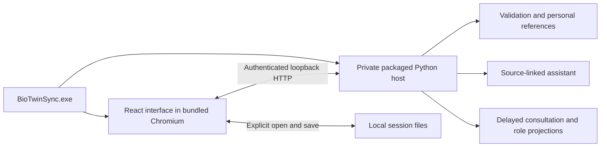

# BioTwin Sync unified desktop

Extract the complete ZIP, open its BioTwinSync folder and double-click **BioTwinSync.exe**. Keep the resources, DLLs and other files alongside the EXE. The application includes Chromium and Python; it does not require a domain, browser setup, Node or Python installation. This is an unsigned Windows x64 prototype.

## Use the workspace

BioTwin Sync shows how a crew can record a measurement and use instructions from a clinician on Earth when messages are delayed. Start with the 30-second example, then follow the workspace's next-step guide. You do not need medical knowledge to explore the example. It uses fictional readings and demonstration instructions, not advice about your health.

The opening includes actual bundled NASA recordings: ECG means the heart's electrical signal; pulse/BVP is an optical pulse recording. The traces replay original samples at 1x. Each excerpt stops at its end; use the recording controls to pause or replay. Reduced-motion preferences keep the opening still until playback is requested.

Choose **Watch 30-second example** for the onboard-support and delayed-review sequence; pause, restart or select a phase to rehearse. The fixed scenario sends evidence to Earth at +20 simulated minutes and returns the review at +40. **Actual local rule engine · synthetic inputs** shows the existing backend checking a returned instruction against newer onboard evidence. Its reaction-time example is separate from the NASA waveforms. Recording time and mission time remain separate, and this presentation does not modify the active crew session. Source details explain the real recordings and the separate NLSP/UTMB reference work.

Choose **View example checks** in the top bar to inspect three isolated synthetic inputs using one unchanged authored rule. A fresh 420 ms reading selects A; a fresh 585 ms reading selects B; the same 585 ms value beyond the one-hour freshness limit returns UNKNOWN and withholds A/B instructions. The dialog shows the actual evaluator reason, evidence source/method, age and authored checklist. Rule values are rounded for readability; expand **Exact stored condition & timing** for full precision. Opening pauses playback, Escape closes the dialog, and reopening starts with the first case. These examples do not change your workspace or establish clinical benefit.

Choose **Open workspace** for the detailed tools below. Use the mission-monitor return control to resume the presentation. The [30-second demo guide](demo-30s.md) contains the shot sequence and voiceover.

The workspace follows four steps. Its next action changes with the actual session:

1. **Record a reading.** Practice with synthetic measurements, or start a new recorded session for your own entries. The guided example is read-only. On Monitor, select a measurement around the body to see its number, units and history. A missing reading means no usable reading is available; it is not a health assessment.
2. **Send it to Earth.** Send the consultation, then advance simulated delivery. A flight surgeon is the clinician reviewing the evidence on Earth. Change role or open the other terminal to see exactly what has arrived there. The recipient cannot see later onboard measurements before they are delivered.
3. **Review the reply.** In the Earth role, write instructions for both outcomes of a numeric comparison. Return to the crew role and advance delivery. BioTwin checks the returned rule against the latest compatible onboard evidence. The example demonstrates this software behavior; it does not recommend a medical threshold.
4. **Record what was done.** In Self-check, read an instruction, perform the relevant demonstration action, and explicitly record a completion note. Send follow-up to Earth. Viewing or selecting a step never completes it.

**Quick guide** explains the workflow without changing the session. The technical checks show what data the evaluator actually used, including device/method matching, quality and availability. A check that is missing or held does not become a pass just because a number is visible. Evidence identifiers establish snapshot consistency, not clinician identity.

Use **Session & demo options** for new sessions, practice modes, **Export session JSON** and **Open saved session**. Replacing a session requires confirmation; export existing work first. Complete the Windows Save dialog after requesting an export. The app can show that it requested a download, but cancelling the dialog does not create a saved file. Opening a saved file establishes an opened baseline; later session changes need another export.

Additional tools are available when needed:

- **Measurements:** enter readings with their device, method and actual acquisition time, import supported CSV/JSON, or run the five-trial reaction check with Space. Measurement entry uses your computer's local time, separate from the simulated delivery clock. Losing focus cancels a reaction check; browser timing is uncalibrated and is not a diagnostic test.
- **Assistant:** record an intake, preview source-linked guidance, explicitly record actions, and reassess when evidence changes. Earth receives only records included in delivered evidence.
- **Recordings:** import supported signal JSON, inspect samples and signal-quality diagnostics, mark review segments and manage repeat requests. Bundled NASA excerpts remain separate source participants.

An action form stays bound to the evidence reviewed when it opened. If another terminal changes that evidence, close the form, review the refreshed view and reopen the action. This prevents a draft from silently applying to a different snapshot.

New saved files retain the exact delivery clock, including pending packets and advances with no new observation. Older files disclose an inferred clock based on actual events; scheduled arrivals do not cause delivery merely by reopening. Historical completions stay visible after evidence changes. Sending a follow-up containing only historical work requires confirmation and does not mark the current steps complete.

Watch the recorded-session storage warning. The 2 MiB limit includes full historical snapshots and can be reached before 500 observations. If capacity is reached, the current session and draft remain available: save/export the session, then explicitly start a new recorded session and re-enter the retained draft there. This bounded prototype is not long-duration storage.

## How it runs

The app uses a private loopback connection on this computer. It does not upload health data or require an Internet connection. Public source links open in the default browser only when selected. The renderer has no general filesystem or Node access; file selection and export use ordinary dialogs.

## Scope and limits

This release unifies the recorded measurement, saved-session, consultation, assistant and signal-review workflows. The source tree retains the separate native research/model demonstration and historical reference-library tools. Those are not exposed through the React release.

Recorded inputs, synthetic scenarios and NASA ground flight-simulation recordings are separate. Manual entries are operator-supplied observations. Browser reaction measurements and native keyboard measurements have different acquisition identifiers and cannot silently share a personal baseline. Existing experimental model gates remain unchanged. Nothing here establishes clinical validity, flight approval or live sensor capture.

The distribution is larger than the native build because it includes its own browser engine. Same-machine tests do not substitute for trying the extracted ZIP on another Windows computer. Session exports are ordinary unencrypted local files.
